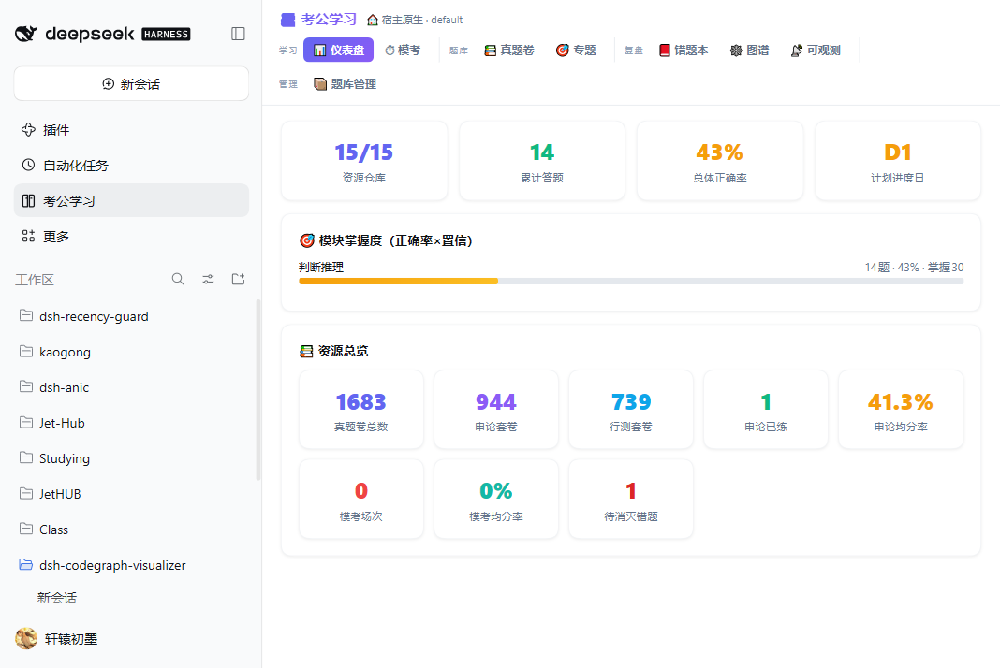
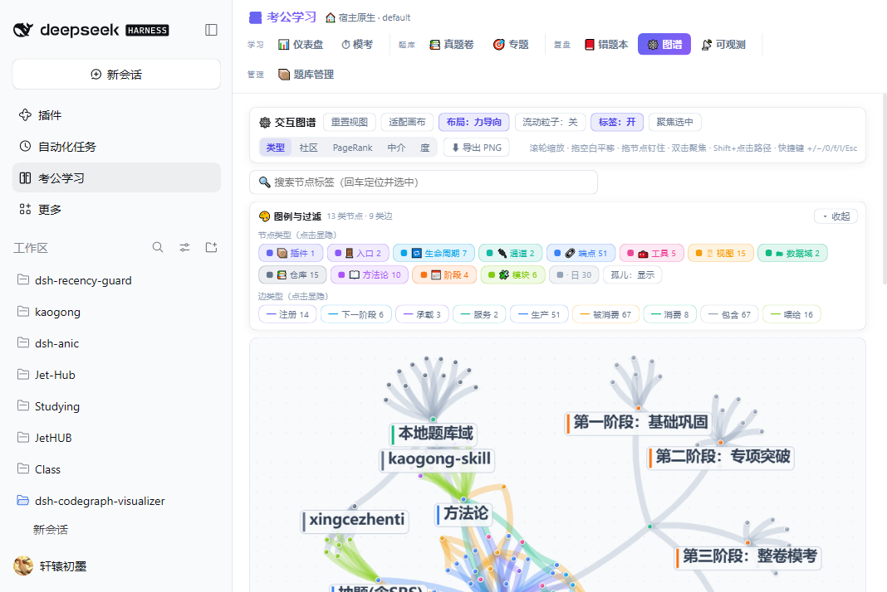
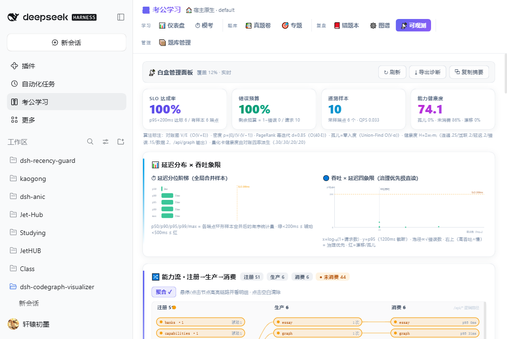
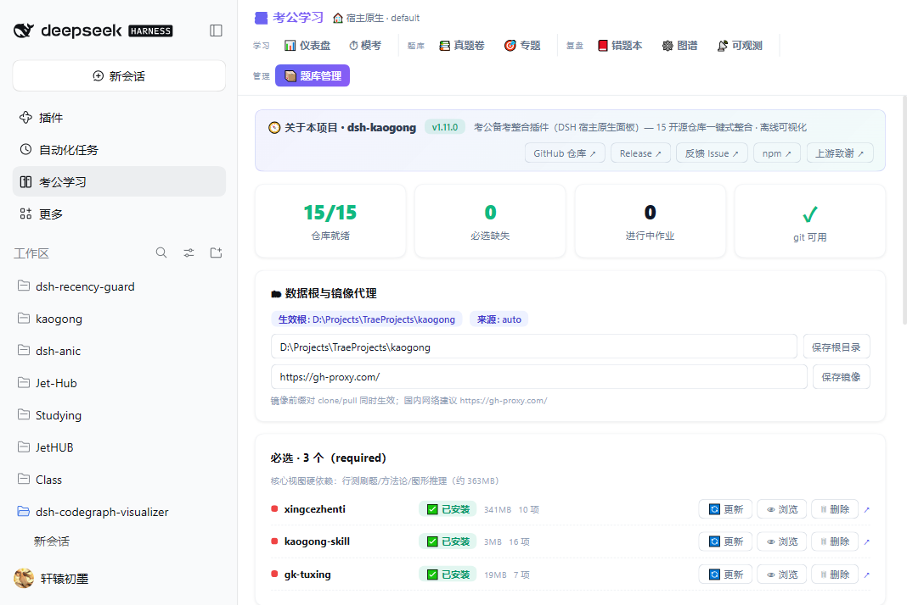

# dsh-kaogong — 考公备考整合插件（DSH 宿主原生面板）· v1.21.0

[](https://www.npmjs.com/package/dsh-kaogong)
[](./LICENSE)
[](https://github.com/topics/dsh-plugin)
[](#-开发与验证)

> **一句话**：把 **16 个**优秀开源考公仓库整合为 [DeepSeek Harness](https://github.com/deepseek-ai)（DSH）宿主内的**原生**学习平台 ——
> 刷题 / SRS 错题本 / 真题卷 / 整卷模考 / 申论评改 / **花生十三体系方法论** / 可交互知识图谱 / 白盒可观测，**完全离线可用**。

> ⚠️ **安装前必读（一句话版）**：本插件是**整合与可视化层**，npm 包**不含任何题库与方法论语料**。
> 装好插件后，打开「📦 题库管理」→ **一键安装必选包**（`huasheng13` + `xingcezhenti` + `gk-tuxing`），核心功能即刻可用。
> 题库管理依赖 **`git`**（浅克隆/更新），请先确认宿主机可执行 `git --version`。

---

## 📑 目录

- [🚀 快速开始（3 步）](#-快速开始3-步)
- [✅ 前置条件](#-前置条件)
- [📦 安装](#-安装)
  - [方式一：npm（推荐）](#方式一npm推荐)
  - [方式二：GitHub 源码](#方式二github-源码)
  - [方式三：插件市场](#方式三插件市场)
- [🗂 首次使用：安装题库数据](#-首次使用安装题库数据)
- [🔧 升级 / 卸载 / 自检](#-升级--卸载--自检)
- [✨ 核心特性](#-核心特性)
- [📖 花生十三体系方法论](#-花生十三体系方法论)
- [🗂 数据根与题库管理](#-数据根与题库管理)
- [🏗 架构](#-架构)
- [📐 数学模型研究文档](docs/research/README.md)
- [❓ 故障排查（FAQ）](#-故障排查faq)
- [🙏 致敬上游](#-致敬上游全部数据与成果归原作者)
- [🧪 开发与验证](#-开发与验证)
- [⚖️ 许可与免责](#-许可与免责)

---

## 🚀 快速开始（3 步）

```bash
# 1) 装插件（在 DSH 会话/控制台）
#    npm 用户：文档见下方「安装」；源码用户：
#    plugin_manager install_bundle <克隆目录>/dsh-kaogong

# 2) 刷新 GUI → 点左栏「📚 考公学习」→ 进入「📦 题库管理」

# 3) 点「🚀 一键安装全部必选」→ 完成后即可刷题 / 查方法论
```

国内网络建议先在「题库管理 → 镜像代理」填 `https://gh-proxy.com/` 再安装，克隆速度显著提升。

## ✅ 前置条件

| 项 | 要求 | 说明 |
|---|---|---|
| Node.js | **≥ 22.19** | 与 DSH 宿主一致；深度题库用到内置 `node:sqlite` |
| DSH 宿主 | `>=0.2.0-rc.2 <0.2.1-0` \|\| `>=0.2.1-rc.0 <0.3.0-0` \|\| `>=0.3.0-rc.0 <0.4.0-0` | `package.json` 的 `peerDependencies` / `engines.dsh` 已声明（兼容闸门可校验） |
| **`git`** | 任意近期版本 | **题库管理靠 `git` 浅克隆下载数据**（`repoManager.ts` 的 `spawn('git', …, { windowsHide: true })`）；无 git 时安装会受控报错而不会崩宿主 |
| 磁盘 | 必选约 **360MB**，全量约 **2.2GB** | 按需分层安装，可选包不必一次拉全 |
| 网络 | 首次装数据需可访问 GitHub | 国内建议配镜像代理 |

## 📦 安装

### 方式一：npm（推荐）

```bash
# 在 DSH profile 中作为 bundle 引入（版本以 npm 最新为准：1.13.1）
npm install dsh-kaogong

# 或用 DSH 自带插件命令（把 npm 包装进当前 profile）
npx @deepseek-ai/dsh plugin add dsh-kaogong
```

npm 包内已包含 `cordis.patch.yml`（bundle 声明 `dsh.bundle.patch` 指向它）与 `data/study-plan.md`（学习计划模板），
**装完即注册双入口**，无需额外构建。

> 📌 自 v1.13.1 起修复：1.11.0 / 1.12.0 / 1.13.0 的 npm tarball **缺失 `cordis.patch.yml`**（`files` 白名单漏列），
> 导致按 npm 安装的 bundle 缺 patch。现已在白名单补入，并由 smoke 的 `R28` 断言实测守卫（`npm pack --dry-run` 校验）。

### 方式二：GitHub 源码

```bash
git clone https://github.com/xuanyuanchumo/dsh-kaogong.git
```

然后在 DSH 内：

```
plugin_manager install_bundle <克隆目录>/dsh-kaogong
```

源码安装会由 `prepare` 脚本自动构建（`tsc` → `scripts/bundle-client.mjs` 合并为宿主单文件 combo），
因此需要能安装 `devDependencies`（TypeScript）。若构建失败，先在该目录执行 `npm install && npm run build`。

### 方式三：插件市场

本插件已收录于 [awesome-dsh-plugin](https://github.com/awesome-dsh-plugin/awesome-dsh-plugin)（`category: tools`），
可在支持该索引的插件市场/面板中搜索 **`dsh-kaogong`** 安装。

## 🗂 首次使用：安装题库数据

1. 打开左栏「📚 考公学习」→ **📦 题库管理**
2. （国内网络）在「镜像代理」填 `https://gh-proxy.com/` 并保存
3. 点「🚀 **一键安装全部必选**」（服务端队列化，并发 2 自动补位，可看批次进度条），也可逐项安装：

| 级 | 仓库 | 体积 | 装完可用的功能 |
|---|---|---|---|
| 必选 | `huasheng13` | 336KB | 花生十三体系方法论（25 篇 + BM25 检索） |
| 必选 | `xingcezhenti` | 341MB | 行测刷题（58,890 题） |
| 必选 | `gk-tuxing` | 19MB | 图形推理（354 题） |
| 推荐 | `gwy-zhenti` | 626MB | 真题卷 1,683 套 / 整卷模考 / 申论评改 |
| 推荐 | `GongkaoNaoku` | 120MB | 深度题库（27,506 题五维标注） |
| 推荐 | `kaogong-skill` | 3MB | 专题「另见」区的十主题方法论 |
| 可选 | 其余 9 个 | 见面板列表 | 检索增强 / PDF 试卷 / 笔记模板 / 面试素材 |

> 体积以面板分级列表为准（单一事实源 `REPOS_META`），本文不写死合计值，避免漂移。

**面板自带的故障恢复能力**（cycle-20）：

| 能力 | 行为 |
|---|---|
| 半成品自动清理 | clone 中断留下的空目录会被自动清理并重装（不会卡在「目录已存在拒绝覆盖」） |
| 作业历史 | 「🕘 最近作业」保留失败原因与耗时，上次为什么失败一目了然 |
| 健康巡检 | 空仓库 / 缺 `.git` / 半成品会被显式徽章标记，不再混在「已安装」里 |
| 旧根提示 | 切换数据根后提示「旧根仍有 N 个仓库（数据未删除）」+ 一键切回 |
| 空间与可写预检 | 面板显示可用磁盘空间；安装前校验数据根可写与上游地址形状 |
| 配置校验 | 数据根须为绝对路径、镜像须为 http(s)，非法输入不落盘 |

装完即可用。未装对应数据时相关视图会**诚实降级并给出安装引导**，不会白屏、不会假报成功。

## 🔧 升级 / 卸载 / 自检

**升级**

```bash
npm install dsh-kaogong@latest      # 或 plugin_manager upgrade / 重新 install_bundle
```

升级代码不影响已下载的题库数据与学习进度（**v1.16 起用户数据外置**：进度/错题本/配置在 `~/.dsh/kaogong/`（`DSH_HOME` 感知，`KG_DATA_DIR` 可覆盖），与包彻底分离——市场/npm 升级整目录替换包也不丢数据；旧版本包内数据在首次启动时自动原子迁移到新位置，`📦 题库管理` 面板「🛡 数据安全」卡可查位置与迁移状态）。

**卸载**

```
plugin_manager remove_bundle dsh-kaogong     # 仅移除插件
```

题库数据与进度**不会被删**；如需彻底清理，删除数据根下的对应仓库目录与 `~/.dsh/kaogong/progress/` 即可。

**自检（三条命令，判断装没装对）**

```bash
git --version                     # 题库管理前置
# 插件侧：确认版本与能力注册
curl -s http://127.0.0.1:51093/kaogong/api/capabilities | head -c 300
# 预期含 "version":"1.13.1"、6 个工具、57 个端点
```

界面自检：左栏出现「📚 考公学习」图标 → 点击进入 → 「📦 题库管理」显示仓库清单（16 项）即正常。

## ✨ 核心特性

| | |
|---|---|
| 🏠 **宿主原生** | DSH Web GUI 双入口：左栏「考公学习」全屏沉浸面板 + 右侧 Sidebar 并排标签；同源路由零 CORS，**非 iframe** |
| 📦 **一键式题库管理** | 必选/推荐/可选三级分装 · `git` 浅克隆/更新/删除 · 目录浏览 · 自定义数据根 · 镜像代理 · 作业实时日志与取消 · **「关于本项目」卡**（GitHub/Release/Issue/npm 一键跳转） |
| 🔒 **跨项目隔离** | 进度 / 专项记忆 / 图谱缓存 / 方法论链路计数全部按工作区命名空间分槽——不同项目互不污染；Windows 子进程静默（`windowsHide`，无控制台闪现） |
| ✏️ **智能刷题** | 58,890 题行测真题 · 五箱 SRS 错题本（答错收集 → 回炉升箱 → 掌握）· 弱点加权抽题 · 键盘流 |
| 💾 **专项刷题记忆** | 进入刷题 / 图形推理 / 深度题库自动显示「上次练到 xx 的 xx 题」，一键跳回原题 |
| 📚 **真题卷 1,683 套** | 申论 944 / 行测 739（2008–2026）· 科目/省份/年份三维筛选 · 材料逐份折叠 · 题目配图 |
| ✍️ **申论离线评改** | 零模型规则引擎：采分点覆盖 50% + 结构 20% + 字数 15% + 语言 15%；大作文五档字数分档 |
| ⏱ **整卷模考** | 限时倒计时 · 服务端判分（答案不下发，防作弊）· 模块得分分布 · 历史战绩 |
| 🧠 **深度题库** | 27,506 题五维标注（考点定位 / 推理链 / 最快解法 / 易错点 / 母题思维）· 10,647 题含图 |
| 📖 **花生十三体系方法论** | 25 篇六模块语料 · **BM25 中文检索**（bigram + 单字）· 覆盖矩阵（0.9756，缺口如实暴露）· 74 题配套练习 · 白盒消费链路 |
| 🕸️ **交互图谱** | Canvas 2D 力导向（FR 模型）· 三布局（力导向/分层/环形）· 边流动粒子 · 五档着色 · 小地图 · 路径分析 · 导出 PNG |
| 📡 **白盒可观测** | 生命周期状态机 · 能力对账（注册 → 生产 → 消费三态灯）· 端点性能表 · 延迟分位阶梯 · 吞吐×延迟四象限 · **方法论链路卡** · 诊断导出 |
| 🔌 **可选 AI 增强** | **6 个**宿主工具（`kaogong_launch` / `ai_tutor` / `ai_plan` / `ai_shenlun` / `ai_essay_review` / **`ai_method`**）把离线基线分+方法论交模型深度点评；**无模型时全部离线功能不受影响** |

### 界面预览

| 仪表盘 | 知识图谱 | 白盒可观测 | 题库管理 |
|---|---|---|---|
|  |  |  |  |

## 📖 花生十三体系方法论

> 入口：**🎯 专题 → 📖 方法论**（**不设独立一级导航**，这是刻意的信息架构选择；分区锚点 `data-kg-hub-tab=method`）。

- **语料**：25 篇（20 references + 5 examples，约 336KB），上游 [huasheng13-skill](https://github.com/WangJunqing-coder/huasheng13-skill)。
  **不随 npm 包分发**：由「📦 题库管理」统一下载到 `<数据根>/huasheng13`，与其它题库走**同一条**安装/更新/删除链路（无内置旁路）。
  未安装时 6 个端点**诚实降级**（`degraded:true` + 安装引导），装好后 **3 秒内自愈、无需重启**。
- **六模块覆盖**：资料分析 1 / 数量关系 1 / 言语理解 **0.889** / 判断推理 1 / 常识判断 1 / 申论 1 → `overall = 0.9756`（40/41）。
  `yanyu` 的 0.889 是**真实缺口**（专项突破篇缺公式），不是缺陷；常识/申论不考公式，覆盖矩阵按 `dims` 不计公式维度（否则会产生**假阴性**）。
- **BM25 检索**：`k1=1.2, b=0.75`，字段加权 title×3 / heading×2 / body×1；中文用字符 bigram + 单字双粒度（零依赖、无分词库）。
  服务端只做尾部裁剪（`score < max(1.0, top×0.15)`，**永远保留首条**）+ 三档 `confidence`（high/medium/low）+ `phraseHit`；
  **低置信度结果不丢弃**，靠提示让调用方判断（阈值过滤会误杀「数量 / 判断」这类真实短查询）。
- **74 题配套练习**：资料 10 / 数量 18 / 言语 15 / 判断 18 / 申论 13。其中 **32 题有字母答案可自动判分**，
  **42 题文字作答走「查看解析 + 自评」**（数量 18、申论 13、判断 8、资料 2、言语 1）——**不臆造字母答案**。
- **白盒链路**：`/api/huasheng13/trace` 输出真实端点命中 / p50 / p95 / 检索命中率 / 最近事件，`📖 方法论链路` 卡与图表面板同源消费。
- **结构**：分区主视图 = 花生十三体系（`data-kg-hs13-root`）；底部「▸ 另见：kaogong-skill 十主题 + 深度题库母题精选」默认折叠，
  并明确标注其依赖外部仓库（`kaogong-skill` 已从必选降为**推荐**）。

> 适配库开发规范（25 篇清单 / 新增语料四步法 / 检索与覆盖口径 / 降级语义）见 [docs/agents/METHODOLOGY.md](./docs/agents/METHODOLOGY.md)。

## 🗂 数据根与题库管理

**数据根解析优先级**（高 → 低）：

| 优先级 | 来源 | 说明 |
|---|---|---|
| 1 | 环境变量 `KG_REPOS_DIR` | CI / 高级用户 |
| 2 | `data/repos-config.json` | 题库管理面板「保存根目录」写入 |
| 3 | 开发态上级目录 | 目录内含任一已登记题库仓库时自动识别 |
| 4 | `data/repos/`（托管默认） | npm 安装态，配合一键克隆 |

**管理面板能力**：安装（`--depth 1` 浅克隆）· 更新（`pull --ff-only`）· 删除（仅清数据目录，进度不受影响）· 目录浏览 ·
作业实时日志与取消 · 并发上限 2 · 非 git 目录保护（拒绝覆盖用户数据）· 路径穿越防线 ·
安装/换根后 `paperIndex` / `naoku` / `graphCache` 三级缓存自动失效重建。

**安全边界**：仅绑定 `127.0.0.1`；UI 只读仓库内容；唯一写路径是判分/进度；子进程只执行固定 `git` 子命令并 `windowsHide`。

## 🏗 架构

```
src/
├── shared/manifest.ts     # 能力单一事实源：端点/工具/视图/lifecycle + REPOS_META(16) + HUASHENG13_META(25 篇) + 图算法族
├── adapters/              # 数据源适配层（16 仓库只读隔离）
│   ├── repoData / paperData(索引+快照+分块预热) / paperParse / naoku(node:sqlite) / tuxing
│   └── huasheng13(BM25+覆盖矩阵) / huasheng13-text(分词等纯函数)
├── server/
│   ├── dataRoot.ts        # 数据根四级解析 + repos-config 持久化
│   ├── repoManager.ts     # 题库管理域：git 作业/校验/镜像/浏览/删除
│   ├── methodologyApi.ts  # 花生十三体系方法论域（6 端点 + trace 分槽）
│   ├── http.ts            # 域链分发 + 信标 + 遥测 + 图谱 + 崩溃安全启动 + 同源挂载
│   ├── ws.ts / srs.ts     # 工作区命名空间隔离 / 五箱 SRS + 专项记忆
│   └── paperApi / naokuApi / tuxingApi / dataApi / topicTree
├── host/index.ts          # Cordis Host 半：同源路由(主) + 端口兜底 + 6 个工具
├── client/                # Cordis Client 半（14 模块，构建期合并为宿主单 combo）
│   ├── client.ts          # 双入口注册 + 视图分发 + 通道探测
│   ├── study-view / papers-view / graph-{view,engine,physics,transition,canvas,analytics}
│   ├── huasheng13-view + huasheng13-md   # 方法论五分区 + 零依赖 markdown 渲染
│   ├── obs-view           # 白盒管理面板
│   └── repos-view         # 题库管理面板
└── ui/                    # 零依赖 SPA 兜底页（独立端口通道）
```

**双通道**：宿主同源 `/kaogong/*`（主，零 CORS）→ 独立端口 `127.0.0.1:8400-8404`（兜底，信标发现 + adopt 复用）。

**关键机制**：崩溃安全（`listen` 错误 Promise 受控回传，绝不击杀宿主）· 热重载竞态防线（本代资源闭包持有）·
工作区隔离（`?ws=` → slug+sha1 分文件）· **零 npm 运行时依赖**（Node 标准库 only）· **数据与代码分离**（包内不携带题库与方法论语料）。

## ❓ 故障排查（FAQ）

<details>
<summary><b>装完看不到左栏「考公学习」入口</b></summary>

1. 刷新 GUI（`F5`）；Client 半靠 Web GUI 加载，刷新后才注册双入口。
2. 确认 bundle 真的装配了：profile 的 `package.json` 依赖里应有 `dsh-kaogong`。
3. 看启动日志有无 `dsh: skipping profile bundle "dsh-kaogong"` —— 出现即为 **peer 版本不匹配被跳过**，
   按日志提示调整 DSH 版本或放宽 peer 范围。
4. 若日志报 `import failed` / `Cannot use import statement outside a module`：说明装的包里 client 产物不是合并后的
   combo（见下方「版本 1.13.0 及更早」）。
</details>

<details>
<summary><b>方法论视图提示「语料未安装」</b></summary>

这是**预期降级**，不是 bug：方法论语料要经「📦 题库管理」安装。
去 **题库管理 → 必选包 → 安装 `huasheng13`**（336KB），完成后 3 秒内自愈，**无需重启宿主**。
</details>

<details>
<summary><b>题库安装失败 / 一直卡住</b></summary>

- 先确认 `git --version` 可用（题库管理靠 git 子进程）。
- 日志里若是 `Could not resolve host` / `Connection reset`：属网络问题，配镜像代理
  `https://gh-proxy.com/` 后重试；也可在面板里点「⏹ 取消」再重装。
- 若提示「目录已存在但不是 git 仓库」：为保护你的数据拒绝覆盖，先手动删除该目录再装。
</details>

<details>
<summary><b>端口 8400 被占用 / 弹出端口冲突</b></summary>

独立端口只是**兜底通道**。宿主同源路由正常时根本不用它；
若被占用，插件会自动在 `8400-8404` 区间寻找可用端口，或 adopt 已有实例，不会崩宿主。
</details>

<details>
<summary><b>数据下载到了别处 / 想换数据根</b></summary>

用 **题库管理 → 数据根与镜像代理 → 保存根目录**（写入 `data/repos-config.json`），
或设环境变量 `KG_REPOS_DIR`。换根后缓存自动失效重建，进度按 `?ws=` 命名空间仍各自独立。
</details>

<details>
<summary><b>升级后版本号没变</b></summary>

端口/界面读的是**已装载**的那份产物。升级 npm 包后需要让宿主重新装载：
在插件管理里对 `dsh-kaogong` 做一次 `disable → enable`（热重载），或重启宿主。
</details>

<details>
<summary><b>用 1.13.0 或更早的 npm 包安装，插件完全不生效</b></summary>

那三个版本（1.11.0 / 1.12.0 / 1.13.0）的 tarball **漏了 `cordis.patch.yml`**，bundle 因此缺 patch。
**升级到 1.13.1 或更新**即可；该缺陷已由 `R28` 断言（`npm pack` 实测）永久守卫。
</details>

<details>
<summary><b>无模型 / 无网络能不能用</b></summary>

能。全部核心功能（刷题、SRS、真题卷、模考、申论离线评改、方法论检索、图谱、白盒面板）都是**离线规则引擎**，
6 个 AI 工具只是可选增强：没有模型时它们自然用不上，不影响其余功能。
</details>

## 🙏 致敬上游（全部数据与成果归原作者）

本插件仅做整合、解析与可视化。题库数据与解题方法论均来自以下开源仓库（排名不分先后）：

| 仓库 | 作者 | 内容 |
|---|---|---|
| [huasheng13-skill](https://github.com/WangJunqing-coder/huasheng13-skill) | [@WangJunqing-coder](https://github.com/WangJunqing-coder) | 花生十三体系方法论 25 篇（六模块 + 策略 + 练习） |
| [xingcezhenti](https://github.com/ERRRC/xingcezhenti) | [@ERRRC](https://github.com/ERRRC) | 515 套卷 58,890 题行测真题库 |
| [kaogongzhentizhengliu](https://github.com/ERRRC/kaogongzhentizhengliu) | [@ERRRC](https://github.com/ERRRC) | 22,375 篇考点重组深度笔记 |
| [GongkaoNaoku](https://github.com/jangviktor-web/GongkaoNaoku) | [@jangviktor-web](https://github.com/jangviktor-web) | SM-2 引擎 · 27,506 题五维深度标注 |
| [AdministrativeAptitudeTest](https://github.com/jecoat/AdministrativeAptitudeTest) | [@jecoat](https://github.com/jecoat) | 近二十年国考省考选调生试卷 PDF |
| [NovaForge](https://github.com/SiriusFzh/NovaForge) | [@SiriusFzh](https://github.com/SiriusFzh) | 通用笔记模板（LaTeX/Typst/Markdown） |
| [kaogong-skill](https://github.com/KeWang0622/kaogong-skill) | [@KeWang0622](https://github.com/KeWang0622) | 考公 AI 技能包（出题/讲解/批改/复盘） |
| [sakib](https://github.com/vsakib/sakib) | [@vsakib](https://github.com/vsakib) | 公考知识文档库 |
| [developer2gwy](https://github.com/miss-mumu/developer2gwy) | [@miss-mumu](https://github.com/miss-mumu) | 程序员上岸公考实践指南 |
| [gwy-zhenti](https://github.com/ProfessorZhi/gwy-zhenti) | [@ProfessorZhi](https://github.com/ProfessorZhi) | 国考省考行测申论图文真题 1,683 套 |
| [Exam_Database](https://github.com/869909419/Exam_Database) | [@869909419](https://github.com/869909419) | 多渠道考公素材题库 |
| [qiuzhao-epi-bank](https://github.com/Timothy-yqw19/qiuzhao-epi-bank) | [@Timothy-yqw19](https://github.com/Timothy-yqw19) | 秋招行测/银行 EPI 刷题（697 题 PWA） |
| [xingce-app](https://github.com/YMDHZBSJ/xingce-app) | [@YMDHZBSJ](https://github.com/YMDHZBSJ) | 离线行测 App（22,298 题） |
| [gk-tuxing](https://github.com/Cha551/gk-tuxing) | [@Cha551](https://github.com/Cha551) | 图形推理真题 354 道逐题解析 |
| [civil-exam-agent](https://github.com/tongnian0666-code/civil-exam-agent) | [@tongnian0666-code](https://github.com/tongnian0666-code) | 公考督导智能体系统 |
| [yunduanqiqu](https://github.com/hwlvipone/yunduanqiqu) | [@hwlvipone](https://github.com/hwlvipone) | 申论范文/面试真题/素材分享 |

同时感谢 [DeepSeek Harness](https://github.com/deepseek-ai) 宿主提供 `webServer` 同源路由、slots 席位、工具注册与热重载等能力面。

## 🧪 开发与验证

```bash
npm run build        # tsc 类型门 → scripts/bundle-client.mjs 合并 14 模块为宿主单 combo
node smoke.test.mjs  # 317 断言 E2E（信标/adopt/隔离/SRS 闭环/图谱算法确定性/专项记忆/
                     # 三布局/流动粒子/白盒三件套/题库管理 R-P-01..06/
                     # 方法论 HS13-01..10 六端点+降级语义+跨 ws 隔离/
                     # 打包卫生 R28: bundle patch 与随包模板必须入包、语料与调试 overlay 不得入包）
node render.test.mjs # 55 断言真实 React 18 + 真实 client.js 集成渲染（零 role=alert 降级；
                     # 含 C18-01..08 方法论五分区 + 专题枢纽锚点 + 白盒链路卡）
npm run test:all     # 上面两步一起跑
```

**沙箱验证（禁主力直测）**：`node ../_dshcli/node_modules/@deepseek-ai/dsh/lib/bin.js --profile sb-kaogong --port 3181 --no-open`

ANIC 质量流程：`.cycles/`（intent → spec → plan → G0–G3 门禁 → 归档；L4 全自主 + 人类门禁授权）。
工程纪律与事故簿见 [CLAUDE.md](./CLAUDE.md)，Agent 开发文档见 [docs/agents/](./docs/agents/)（含 [METHODOLOGY.md](./docs/agents/METHODOLOGY.md) 适配库规范）。

## ⚖️ 许可与免责

- 本插件**代码**：MIT（见 [LICENSE](./LICENSE)）。
- **题库数据与方法论语料**：版权归各上游仓库及其作者所有，请遵循各自许可；**本插件不重新分发任何数据**。
- 方法论内容基于花生十三**公开**教学体系整理；速算方法（截位直除 / 415 份数 / 假设分配 / ABRX 等）为公考培训行业通用方法，非独家版权；
  示例题使用公开真题或自编数据，不收录任何付费课程原题与讲义原文。
- 仅供个人学习备考使用；题目答案与解析的准确性以上游仓库为准。